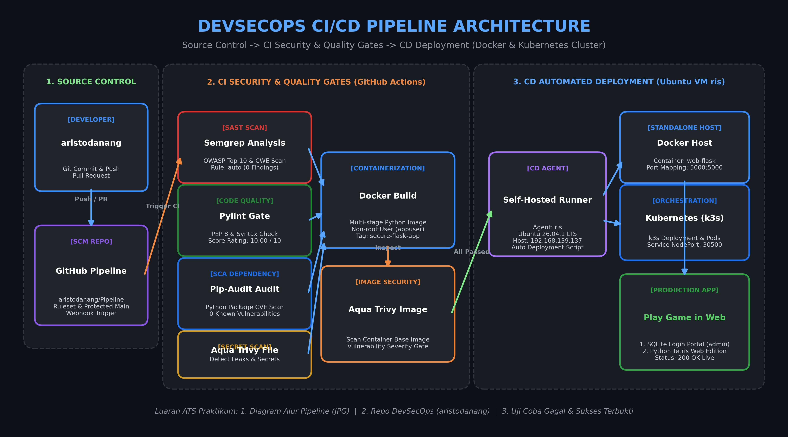

# 🛡️ DevSecOps CI/CD Pipeline - Python Tetris Web Edition

Repositori implementasi arsitektur **DevSecOps CI/CD Pipeline** otomatis yang mengintegrasikan pengujian kualitas kode, pemindaian keamanan statis (*SAST*), analisis kerentanan dependensi (*SCA*), deteksi kebocoran kredensial (*Secret Scanning*), serta otomatisasi *deployment* multi-target ke **Docker Standalone Host** dan **Kubernetes Cluster (k3s)** pada Ubuntu VirtualBox VM.

---

## 📊 Diagram Alur Pipeline (Topologi)

---

## 🚀 Fitur & Tahapan DevSecOps Pipeline

Alur kerja CI/CD diatur pada [`.github/workflows/devsecops.yml`](.github/workflows/devsecops.yml) dengan tahapan berjenjang:

### 1. 🔍 Static Application Security Testing (SAST) - Semgrep
- **Engine**: Semgrep Community Ruleset (`semgrep/semgrep` image).
- **Cakupan**: Memindai kerentanan *OWASP Top 10*, *SQL Injection*, serta *CWE Security Flaws* pada kode backend Flask.
- **Hasil**: 0 Blocking Findings.

### 2. 🧹 Code Quality & Linting Gate - Pylint
- **Engine**: Pylint 4.x (Python 3.10).
- **Cakupan**: Standarisasi kode PEP 8, modularitas, docstrings, dan deteksi error logika.
- **Ambang Batas**: Target $\ge 9.0$ (**Hasil riil: 10.00 / 10**).

### 3. 🛡️ Software Composition Analysis (SCA) - Pip-Audit
- **Engine**: `pip-audit`.
- **Cakupan**: Memindai seluruh paket dependensi Python pada `requirements.txt` terhadap basis data *OSV (Open Source Vulnerabilities)* dan *PyPI Advisory Database*.
- **Hasil**: 0 Known Vulnerabilities.

### 4. 🔑 Filesystem & Secret Scanning - Aqua Trivy
- **Engine**: Aqua Security Trivy Action.
- **Cakupan**: Memindai direktori repositori dari kebocoran token (*hardcoded credentials*, API keys, GitHub PAT).

### 5. 🐳 Containerization & Packaging - Docker
- **Base Image**: `python:3.10-slim`.
- **Keamanan Runtime**: Menggunakan pengguna non-root (`appuser`, UID 1000) untuk mencegah *container escape*.
- **Artifact**: `secure-flask-app:latest`.

### 6. 🚀 Multi-Target Automated Deployment (Ubuntu VM)
- **Host Target**: `ris@192.168.139.137` (Ubuntu 26.04.1 LTS).
- **Agent**: GitHub Self-Hosted Runner (`ris`).
- **Target 1 (Docker Standalone)**:
  - Kontainer: `web-flask`
  - Port: `5000:5000`
  - URL Akses: `http://192.168.139.137:5000`
- **Target 2 (Kubernetes Cluster - k3s)**:
  - Manifests: [`k8s/deployment.yaml`](k8s/deployment.yaml) & [`k8s/service.yaml`](k8s/service.yaml)
  - Pods: `tetris-web` (Replica: 1)
  - Service: `tetris-service` (NodePort)
  - Port: `30500:5000`
  - URL Akses: `http://192.168.139.137:30500`

---

## 🎮 Aplikasi: Python Tetris Web Edition + SQLite Portal

Aplikasi produksi yang di-deploy memiliki alur interaktif:
1. **Portal Login**: Kredensial default `admin` / `supersecret`.
2. **Session Security**: Rute `/` terproteksi sesi, otomatis *redirect* ke `/login` jika belum diautentikasi.
3. **Play Game in Web**: Permainan Tetris responsif dengan procedural Web Audio synthesizer, sistem skor standar PRD, dan tombol Logout.

---

## 👨‍💻 Kontributor & Pengembang
- **Pengembang**: `aristodanang`
- **Email**: `aristo.julianggoro@gmail.com`
- **Repositori**: [https://github.com/aristodanang/Pipeline](https://github.com/aristodanang/Pipeline)
